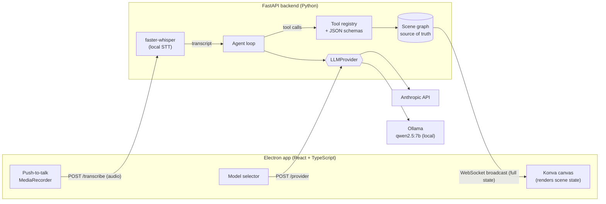

# VoxSpace

**A voice-controlled 2D design canvas driven by a tool-using LLM agent. It runs locally, and the language model can be either a local model or a cloud API.**

Hold a button, say *"add a blue circle"* or *"move the rectangle to the top left,"* and the canvas updates. Speech is transcribed on-device. An LLM agent turns the utterance into structured tool calls, and those calls mutate a shared scene graph that the canvas renders live.

---

## What it demonstrates

- **An agentic tool-use loop.** A natural-language command plus the current scene state go to an LLM, which returns typed tool calls (`create_shape`, `update_shape`, `move_shape`, `delete_shape`, `select_shape`). These are validated and executed against the scene graph.
- **A provider-agnostic LLM layer.** A single `LLMProvider` interface sits in front of both the **Anthropic API** and a **local Ollama model** (`qwen2.5:7b`). Each provider's native tool-call format is normalized into one shape. You can switch providers at runtime from the UI.
- **Local speech-to-text** with `faster-whisper`, running fully on-device.
- **A renderer-agnostic scene graph.** The backend owns one source-of-truth object model. The Konva canvas only *reads* it, so a future 3D renderer can sit behind the same model.
- **Measured tradeoffs.** A repeatable benchmark compares the local and cloud providers on accuracy and latency (results below).

## Architecture



**Request flow for one voice command:**
1. Audio is recorded in the renderer and sent to `POST /transcribe`, where faster-whisper (`small`, int8, CPU) returns the transcript.
2. The transcript goes to `POST /agent`. The agent builds a prompt from the current scene JSON and the utterance, then calls the active `LLMProvider`.
3. The provider's response is normalized to `ToolCall(name, arguments)`, and each call runs against the `SceneGraph`.
4. The backend broadcasts the full updated scene over the WebSocket, and every connected client re-renders.

Manual edits (toolbar buttons, drag-to-move) go through the same scene graph over the WebSocket, so voice and mouse input can never drift out of sync.

## Benchmark: local vs. cloud LLM

The same 6 test commands cover all 5 tools. Each starts from a freshly seeded scene and is checked for the right tool, the right target object, and sensible argument values.

| Provider | Accuracy | Avg latency |
|---|---|---|
| Anthropic (`claude-opus-4-8`) | **100%** (6/6) | 2.02 s |
| Ollama (`qwen2.5:7b`, local) | 83% (5/6) | **0.87 s** |

The local model's one miss was a specific failure mode, not random noise. For *"move the circle to the top left,"* it returned `y=600`, the **bottom** of the canvas, because it inverted the screen-coordinate y-axis. That makes coordinate conventions a named category for the upcoming evaluation harness.

**Takeaway:** the local model is about 2.3× faster, runs at no per-request cost, and keeps transcripts on the machine. The cloud model is more reliable on spatial reasoning. Once undo makes a wrong answer cheap to fix, the faster local model becomes a reasonable default for an interactive voice tool.

Reproduce it with `python tests/benchmark_providers.py`, run from `backend/`.

## Tech stack

| Layer | Choice |
|---|---|
| Desktop shell | Electron (via `vite-plugin-electron`) |
| Frontend | React 19 + TypeScript, Vite |
| Canvas | Konva.js / react-konva (retained-mode scene graph) |
| Backend | Python 3.11, FastAPI, WebSockets |
| Speech-to-text | faster-whisper (local) |
| LLM | Anthropic API, Ollama (`qwen2.5:7b`) behind a common interface |

Design decisions and their rationale are in [`docs/DESIGN.md`](docs/DESIGN.md).

## Project structure

```
backend/
  app/
    main.py           FastAPI app: /transcribe, /agent, /provider, /ws
    agent.py          Agent loop + provider selection
    llm_provider.py   LLMProvider protocol, ToolCall, ProviderResponse
    providers.py      AnthropicProvider, OllamaProvider
    tools.py          Tool JSON schemas + executor
    scene.py          SceneObject model + SceneGraph store
    stt.py            faster-whisper wrapper
  tests/
    benchmark_providers.py
frontend/
  electron/           Electron main + preload
  src/
    Canvas.tsx        Konva rendering of scene state
    useScene.ts       WebSocket sync + manual CRUD
    useVoiceInput.ts  Push-to-talk recording
    useAgent.ts       Sends transcripts to the agent
    useProviderSetting.ts  Runtime model switch
```

## Getting started

**Prerequisites:** Node 20+, conda (or any Python 3.11 env), and optionally [Ollama](https://ollama.com) for the local model.

**Backend**
```bash
conda create -n voxspace python=3.11 && conda activate voxspace
cd backend
python -m pip install -r requirements.txt
cp .env.example .env          # then add your ANTHROPIC_API_KEY
python -m uvicorn app.main:app --port 8000
```

**Frontend**
```bash
cd frontend
npm install
npm run dev                   # launches the Electron app
```

**Local model (optional)**
```bash
ollama pull qwen2.5:7b
```
Choose the model from the selector in the app, or set `LLM_PROVIDER=ollama` in `backend/.env`.

## Status & roadmap

| | Milestone |
|---|---|
| ✅ | Scene graph + manual canvas, synced over WebSocket across clients and reloads |
| ✅ | Push-to-talk speech-to-text (10/10 accuracy on the app's command vocabulary) |
| ✅ | LLM tool-use agent loop executing voice commands end-to-end |
| ✅ | Swappable local/cloud LLM provider + benchmark |
| 🚧 | **Reference resolution:** resolving *"the second circle,"* *"make it bigger,"* and asking a clarifying question when a reference is ambiguous |
| ⬜ | Typed input as an alternate entry point; command history with undo |
| ⬜ | Labeled evaluation set scoring tool, parameter, and reference-resolution accuracy for both providers |
| ⬜ | 3D renderer (Three.js) behind the same scene-graph interface |

Right now the LLM picks target objects by id from the scene context. That works for unambiguous references like "the rectangle." The reference-resolution work replaces this with a hybrid approach: the LLM extracts a structured description of the target (type, color, ordinal, pronoun), and a deterministic resolver matches it against the scene graph. That makes resolution testable and consistent across providers.
